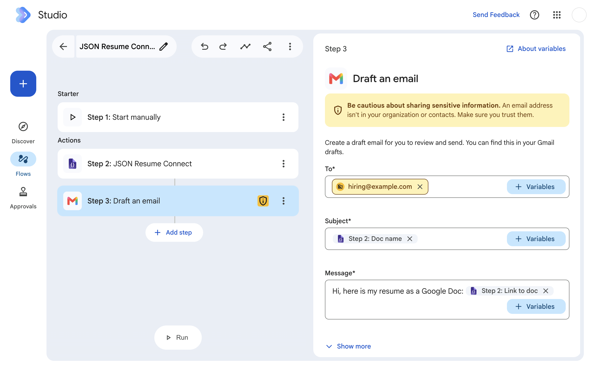

<p align="center">
  
</p>

<h1 align="center">JSON Resume Connect</h1>

<p align="center">
  <a href="https://github.com/ismailkattakath/jsonresume-connect/actions/workflows/ci.yml"></a>
  <a href="https://scorecard.dev/viewer/?uri=github.com/ismailkattakath/jsonresume-connect"></a>
  <a href="LICENSE"></a>
  <a href="https://github.com/ismailkattakath/jsonresume-connect/releases/latest"></a>
</p>

<p align="center"><b>A step for Google Workspace Studio™: your JSON Resume rendered as a document for Google Docs™, with PDF and DOCX links.</b></p>

<sub>Independent project that works with JSON Resume. Not affiliated with or endorsed by Google LLC.
Google Docs™ and Google Workspace Studio™ are trademarks of Google LLC.</sub>

## Background

| You | The add-on |
|---|---|
| Keep **one** résumé in the open [JSON Resume](https://jsonresume.org) standard | **Connects** to your jsonresume.org account (OAuth 2.1 with PKCE) |
| Add its step to a Workspace Studio flow | **Loads** the résumé and **fails clearly** if it breaks the [schema](https://github.com/jsonresume/resume-schema) — it never silently repairs it |
| Use the links in your next step (e.g. a Gmail draft) | **Renders** a clean academic-CV-style document in your Drive, with **PDF and DOCX** links |

- **Minimal permissions:** only files it creates (`drive.file`) and outbound requests
  (`script.external_request`). See [scopes](docs/reference/scopes.md).
- **No server, no API key, no analytics.**
- **One source on purpose:** the signed-in jsonresume.org account. No URL, paste or Drive field.
- **Out of scope:** tailoring to a job posting. This step never reads a posting, which is
  attacker-controlled text when it arrives from an inbox.

<p align="center">
  
</p>

## Install

Custom steps must be allowed in the Admin console first. Then, in the Apps Script web editor:

1. Create an Apps Script project, runtime **V8**.
2. Copy every file under `src/` into it.
3. **Deploy → Test deployments → Install**, then add the step to a flow.

The admin gates, `clasp`, the URL allowlist and troubleshooting are in
[Deploy the add-on](docs/how-to/deploy.md).

## Usage

```
[starter]
    ↓
[JSON Resume Connect]   ← this step
    ↓
[Gmail: create draft]   ← put docUrl / pdfUrl / docxUrl in the body
```

1. **No account yet?** Create one at jsonresume.org with **Sign in with GitHub**: it stores your
   résumé as a gist.
2. In the step, click **Connect JSON Resume** and approve **"Read your resume"**.
3. **Refresh the Studio page**: Studio does not redraw a step card after a sign-in in another tab.
4. Use the step's outputs (Doc, PDF and DOCX links, name, plain text) in the next step.

## Documentation

| | |
|---|---|
| How-to | [Deploy the add-on](docs/how-to/deploy.md) |
| Reference | [Configuration](docs/reference/configuration.md) · [Outputs](docs/reference/outputs.md) · [Rendering](docs/reference/rendering.md) · [Scopes](docs/reference/scopes.md) · [Tests](docs/reference/tests.md) |
| Explanation | [Notes from building it](docs/explanation/building-notes.md) · [The renderer, run live](docs/explanation/renderer-live-runs.md) · [Renderer design](RENDERER-DESIGN.md) · [Naming](docs/naming.md) |
| Policies | [Privacy](docs/privacy.md) · [Terms](docs/terms.md) · [Security](SECURITY.md) · [Support](SUPPORT.md) |

## Contributing

```bash
npm ci
npm test               # node --test
npm run lint           # ESLint, Google style
npm run format:check   # Prettier, Google settings
```

Read [CONTRIBUTING.md](CONTRIBUTING.md) first: commits follow Conventional Commits, and a change
to the card UI, OAuth or Google APIs also needs a run on Google's servers.

## License

[MIT](LICENSE). The vendored OAuth2 library is Apache-2.0; see [REUSE.toml](REUSE.toml) and
[NOTICE](NOTICE).
