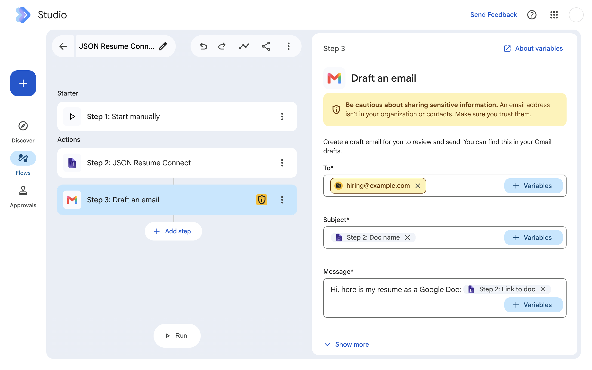

<p align="center">
  
</p>

<h1 align="center">JSON Resume Connect</h1>

<p align="center"><b>Your <a href="https://jsonresume.org">JSON Resume</a>, rendered as a document in Google Docs™ — from a Google Workspace Studio™ flow.</b></p>

<p align="center">
  <a href="https://github.com/ismailkattakath/jsonresume-connect/actions/workflows/ci.yml"></a>
  <a href="https://scorecard.dev/viewer/?uri=github.com/ismailkattakath/jsonresume-connect"></a>
  <a href="LICENSE"></a>
  <a href="https://github.com/ismailkattakath/jsonresume-connect/releases/latest"></a>
</p>

## What it does — in 30 seconds

| You | The add-on |
|---|---|
| Keep **one** résumé in the open JSON Resume standard | **Connects** to your jsonresume.org account (OAuth 2.1 with PKCE) |
| Add its **one step** to a Workspace Studio flow | **Loads** the résumé and **fails clearly** if it breaks the schema — it never silently repairs it |
| Use the links in your next step (e.g. a Gmail draft) | **Renders** a clean academic-CV-style document in your Drive, with **PDF and DOCX** links |

- **Two permissions only:** files it creates (`drive.file`) and outbound requests
  (`script.external_request`).
- **No server, no API key, no analytics.**

<p align="center">
  
</p>

<sub>Independent project. Not affiliated with or endorsed by the JSON Resume project or Google LLC.
Google Docs™ and Google Workspace Studio™ are trademarks of Google LLC.</sub>


# JSON Resume Connect

One custom step for Google Workspace Studio. It loads **your** résumé from your
[jsonresume.org](https://jsonresume.org) account (**Connect JSON Resume**), checks it against the
[jsonresume.org schema](https://github.com/jsonresume/resume-schema), and renders it into a
document for **Google Docs™** in your Drive, with PDF and DOCX download links.

| | |
|---|---|
| Name | `addOns.common.name` and the step's `name` in `src/appsscript.json`, plus `APP_NAME` in `JsonResumeToDoc.gs` (jsonresume.org's consent screen shows it). A test fails if the three differ or the literal appears anywhere else in code. No "Google" in the name: the add-on naming rules forbid it |
| Code | `src/JsonResumeToDoc.gs` (connect, fetch, validate, outputs) · `src/RenderDoc.gs` (HTML → Doc) |
| Vendored | `src/third_party/apps-script-oauth2/OAuth2.gs` |

**One source on purpose** (2026-10-27): the signed-in jsonresume.org account. No URL, paste or
Drive field. **An invalid résumé fails the step** with the first problems listed. It is never
repaired: the fix belongs at the source.

**Out of scope:** tailoring to a job posting lives in another tool. This step never reads a
posting, which is attacker-controlled text when it arrives from an inbox.

## The flow

```
[starter]
    ↓
[JSON Resume Connect]   ← this step
    ↓
[Gmail: create draft]   ← put docUrl / pdfUrl / docxUrl in the body
```

## Configuration: Connect JSON Resume

| Card state | Shows |
|---|---|
| Not connected | **Connect JSON Resume**, plus "After connecting, **refresh** this page" |
| Connected | "Connected to JSON Resume as @username", the **Document title** field, two optional **For later steps** fields, and **Disconnect** |

| Input | Required | Notes |
|---|---|---|
| `title` | no | the Doc's name. Defaults to `<basics.name> — Resume`. Accepts a variable from an earlier step |
| `overrideName` | no | "Name for later steps": replaces the `name` output only |
| `overrideEmail` | no | "Email for later steps", `EMAIL_ADDRESS`: replaces the `email` output only; also lets a resume with no address run |

**The Doc always shows the resume as it is.** The two "for later steps" fields change only the
`name` and `email` variables; the Doc, its title and the Resume (JSON / plain text) outputs are
untouched. A Doc that silently differed from the resume was confusing (operator, 2026-10-27), so an
earlier draft that also rewrote the Doc and added a Photo URL was dropped before release. The resume
on jsonresume.org is never changed. A set but invalid email **fails the step**, fixable, rather than
silently falling back to the resume and hiding the typo.

**Why fields rather than the Google profile.** The JSON Resume schema has no required fields
(v1.2.1 and v1.7.0), and the account's name and email need `openid`/`userinfo` scopes the add-on
does not otherwise ask for. Explicit fields keep the scopes unchanged and the choice visible.

The cards have no header, so they do not repeat the name. The field title matches the manifest
input's description (a test checks it).

**Disconnect** swaps the connected section for the Connect section in place, through
`AddOnsResponseService` `modifyCard` → `replaceSection`. Studio's guides say card navigation is not
supported in Studio add-ons ([update cards](https://developers.google.com/workspace/add-ons/studio/update-cards)).
The earlier `CardService` navigation call was replaced. **Not yet run live:** neither the
replacement, nor cards without a header.

**Labels are sentence case** (Google's add-on style guide), except proper nouns: "Connect JSON
Resume", "Disconnect", "Document title". The connect card links `jsonresume.org` for sign-up; Studio
opens card links in a new tab, which suits it. The bold **refresh** stays text, not a link. A test
checks every card and manifest label.

**If client registration fails** (jsonresume.org down), the card says "JSON Resume sign-in is
unavailable right now. Try again in a few minutes." instead of showing a raw error.

**One spelling:** everything the user reads says **resume**, in ASCII as in the JSON Resume name.
That covers cards, errors, the manifest and the Doc's default title. A test enforces it. Prose in
this README keeps résumé.

1. **No account yet?** Create one at jsonresume.org. **Sign in with GitHub:** the dashboard stores
   your résumé as a GitHub gist it creates for you, using your GitHub sign-in (upstream
   `gistOperations.js`, read 2026-10-27). An email-and-password account cannot create one.
2. Click **Connect JSON Resume** and approve **"Read your resume"** on jsonresume.org.
3. **Refresh the Studio page.** Studio does not redraw a step card after a sign-in in another
   tab, and reopening the step does not help, measured 2026-10-27. Clicking Connect again also
   shows it connected. The card says **refresh** in bold rather than as a link: Studio strips
   bold from card links and opens them in a new tab, so a link cannot refresh this page.

   **The config event does carry the flow's id**
   (`workflow.elementConfiguration.workflowId`, live 2026-10-27), should a link ever be wanted.

**Known upstream bug:** signing in to jsonresume.org **with GitHub** during Connect lands on
`/dashboard` instead of the approval screen
([jsonresume/jsonresume.org#636](https://github.com/jsonresume/jsonresume.org/issues/636)).
Click **Connect JSON Resume** again.

**How the connection works:**

| Piece | Value | Evidence |
|---|---|---|
| Library | [OAuth2 for Apps Script](https://github.com/googleworkspace/apps-script-oauth2), vendored as `src/third_party/apps-script-oauth2/OAuth2.gs` at `aae9287` (Apache-2.0, byte-identical to upstream `dist/OAuth2.gs`; a test pins its sha256) | that commit fixes token refresh for clients without a secret (#513) |
| Client | registered once per deployment through jsonresume.org's self-serve dynamic client registration (`/api/oauth/register`): a public client, **no secret** | measured 2026-10-27 |
| Security | PKCE S256 (required by jsonresume.org) | measured |
| Redirect | `https://script.google.com/macros/d/{scriptId}/usercallback` | measured: accepted |
| Scope | `resume:read` | |
| Tokens | access 1 h, refresh 90 days, kept in the user's own `UserProperties` | measured |
| Fetch | `GET https://jsonresume.org/api/oauth/resume` → `{ username, url, resume }` | measured: 200 |

## Outputs

All `SINGLE`. All `STRING` except `email`, which is `EMAIL_ADDRESS`: the **Draft an email** step's
To field offers only email-address variables, never text (measured live 2026-10-27). Studio shows an
`EMAIL_ADDRESS` output as "<label> email address", so its label is just `Resume`, read as **Resume
email address** (the Gmail starter's "Sender email address" works the same way). The chip labels follow Google's built-in **Create a doc** step (measured
live 2026-10-27: "Link to doc", "Doc name", "Doc location", "Document ID") and the Gmail
starter's "Sender email address". A test pins every id and label, in order. Ids stay stable:
users never see them, and renaming one breaks every flow bound to it.

| Id | Chip | Use |
|---|---|---|
| `docUrl` | Link to doc | the Doc, for a Gmail or Chat step |
| `docName` | Doc name | the name Drive stored (the configured title, or `<name> — Resume`) |
| `pdfUrl` | Link to PDF | `https://docs.google.com/document/d/{id}/export?format=pdf` |
| `docxUrl` | Link to DOCX | `https://docs.google.com/document/d/{id}/export?format=docx` |
| `docId` | Document ID | for a Drive step (share, move) |
| `name` | Name | `basics.name` (or "Name for later steps"), for addressing a message |
| `label` | Headline | `basics.label` |
| `email` | Resume email address | `basics.email` (or "Email for later steps"), usable as a draft's **To**. With no valid address from either, the step **fails** (Studio needs every output on every run) |
| `resumeText` | Resume (plain text) | flattened text for any AI step (summary, cover letter) |
| `resume` | Resume (JSON) | the validated `resume.json`. **Weakest case:** no native step consumes JSON, and it can be up to 2 MB |

**No "Doc location".** The Doc is always created in My Drive's root, so that chip would be a
constant (`https://drive.google.com/drive/my-drive`) that tells the user nothing. Add it if a
folder input ever appears.

`resumeText` renders `basics` then `work`, `projects`, `education`, `skills`, `certificates`,
`awards`, each entry as a headline plus summary plus highlights. Measured on a real registry
résumé: 10,605 characters over 123 lines.

## Rendering


The step renders the résumé to a single-column HTML document. Google converts that into
a **Google Doc** in your Drive. **The Doc is the only file the step creates.**

PDF and DOCX come from Docs' own export links, built from the Doc's id. A link downloads the Doc
**as it is when you open it**, so a hand edit to the Doc is never out of step with a stored copy.
The step fetches nothing to build them.

The export links open for anyone who can open the Doc, i.e. the owner by default. Share the Doc
to share them.

A Studio step cannot output a file: output types are scalars only. So the step returns file IDs
and links, which is the same pattern Google's own Drive picker uses.

**Failure policy:**

| Failure | Studio error | User reads |
|---|---|---|
| Not connected, token revoked (401), no résumé (404), other 4xx, invalid résumé | `ACTIONABLE` + `NOT_RETRYABLE` | what to fix ("Open this step and connect again.") |
| jsonresume.org unreachable, 429 or 5xx; client registration failed | `NOT_ACTIONABLE` + `RETRYABLE` (Studio retries up to five times) | "… is not responding. The step will try again." |
| Drive refuses the create (401/403) | `ACTIONABLE` + `NOT_RETRYABLE` | "Google refused to create the Doc. Check that the add-on is still allowed to create files in your Drive." |
| Drive unreachable, 429 or 5xx | `NOT_ACTIONABLE` + `RETRYABLE` | "Google Drive is not responding. The step will try again." |

**The user never sees an HTTP code, Google's error text or an exception message.** The style
guide says "Don't let the user see any exceptions your code throws". Those details go to
Executions (`console.error`), and the résumé and tokens never do. Tests check every failure
message for raw detail.
- A failed styling call (`documents.batchUpdate`) → the step **succeeds** with the Doc as
  imported. The reason goes to the Executions log.

**Sections rendered**, in order, each skipped when absent or empty: basics (name, label,
contact, profiles, summary), work, projects, education, skills, certificates, awards,
publications, volunteer, languages, interests, references.

**The résumé is untrusted input:** anyone can write anything into a gist. So every value is HTML-escaped. A link becomes an `href` only for `http(s)://` URLs
without credentials, so `javascript:` and `data:` URLs render as plain text. `basics.image` is
left out on purpose: an external image URL is a tracking beacon.

## Scopes

| Scope | Needed by | Grants |
|---|---|---|
| `script.external_request` | the step | outbound HTTPS (jsonresume.org sign-in and fetch; Drive/Docs REST) |
| `drive.file` | the Doc create and styling | **only the files this add-on creates** |

The step does not read your mail or calendar. The renderer cannot see any Drive file it did not
create itself.

**Measured 2026-10-27, with only those two scopes:**

| Call | Result |
|---|---|
| Drive REST `files.create`, HTML → Google Doc (multipart upload) | **works** |
| Docs API `documents.batchUpdate` on that Doc | **works** (the step sets page margins with it) |
| Drive REST `files/{id}/export?mimeType=application/pdf` | **works** (no longer called; see below) |
| Drive REST `files.create` of the PDF bytes | **works** (no longer called) |
| `DocumentApp.create` / `openById` | **fails**: needs `auth/documents` |
| `DriveApp.getFileById` | **fails**: needs `drive.readonly` or `drive` |

So the add-on uses **no `DocumentApp` and no `DriveApp`**. It calls REST through
`UrlFetchApp` with `ScriptApp.getOAuthToken()`. The tests assert that.

## Install

**Web editor** (first run; *Deploy → Test deployments → Install* is editor-only):

1. Create an Apps Script project, runtime **V8**.
2. Copy every file under `src/` into it: `appsscript.json`, `JsonResumeToDoc.gs`, `RenderDoc.gs`
   and `third_party/apps-script-oauth2/OAuth2.gs`.
3. Deploy as a Workspace add-on and add the step to a flow.

**clasp** (after first light): `cp .clasp.json.example .clasp.json`, put your `scriptId` in it,
then `npx @google/clasp push`. `rootDir` is `src/`, so only the add-on is pushed. `.clasp.json`
is gitignored: a script id is yours, not the repo's.

The `.gs` files share **one global scope** in Apps Script. `RenderDoc.gs` uses `str()` from
`JsonResumeToDoc.gs`, and the step uses the renderer's functions, so every file must be in the
project and none may redefine another's names. A test fails on a name defined twice. Load order
does not matter: `OAuth2` is defined at load and used only at call time.

**Why `third_party/` sits inside `src/`:** Google's convention keeps vendored code under
`third_party/<project>/` with its `LICENSE`. clasp pushes only `rootDir`, so the directory lives
under `src/`; nested files push as `third_party/apps-script-oauth2/OAuth2`. Prettier and ESLint
skip it.

## Tests

```bash
npm ci
npm test               # node --test; NODE_OPTIONS=--test-reporter=tap npm test for TAP
npm run lint           # ESLint, Google style
npm run format:check   # Prettier, Google settings (npm run format to fix)
```

Node 24 (`.nvmrc`). Without a global Node: `nix shell nixpkgs#nodejs_24`.

| Suite | Checks |
|---|---|
| `test/manifest.test.mjs` | each file parses; no name defined twice; one step, its name in no source file; callbacks defined; declared outputs == returned; card field == manifest input; exactly two scopes; no DocumentApp/DriveApp/advanced-service call; allowlist rules; OAuth2.gs hash |
| `test/execute.test.mjs` | the whole execute path against fakes: not connected, 401 (resets the connection), 404, HTTP 500, fetch error, non-JSON, over 2 MB, invalid résumé, Drive 403, valid run (one HTML upload, two styling calls, every output), title input, best-effort styling, envelope-only logging, allowlisted URLs only |
| `test/render.test.mjs` | HTML escaping against a hostile résumé, the `href` guard, export links, section order and absence, the live-run styling findings |
| `test/step.test.mjs` | the live event payload shape, strict validation, connect cards, plain-text flattening |
| `test/registry.test.mjs` | real résumés from the live registry; each **skips** when it cannot be fetched |

`npm test -- --test-reporter=tap` does **not** work: npm appends the flag after the glob, and Node
ignores it. Use `NODE_OPTIONS`.

Apps Script cannot run off Google's servers, so the Studio integration itself has to be verified
by installing the add-on. The fakes prove the step's own control flow; the service shapes they
fake were measured live (below).

## Notes from building it

These were **wrong in the first version** and are corrected here. The first draft of this file
presented the wrong shape as a hard-won lesson, which is worse than saying nothing — it would
have stopped the next person re-checking.

- **A Studio step does NOT read `commonEventObject.formInputs`.** That shape is real and correct
  for a Gmail or Chat card callback, and it is the wrong object here. A step execution delivers
  its configured values at `event.workflow.actionInvocation.inputs[id].stringValues[0]` — typed
  arrays keyed by the manifest's declared `dataType`. At execute time `commonEventObject` holds
  only `timeZone`, `userLocale`, `hostApp` and `platform`; there is no `formInputs` key at all.
  Google's calculator reads `…inputs["value1"].integerValues[0]`.
- **A configuration field must be declared in the manifest's `inputs[]`.** There is no
  "config-only field". The card's `setFieldName('x')` binds to `inputs[].id === 'x'`, and that
  binding *is* the delivery channel — Google's own sample carries the comment
  `//"FieldName" must match an "id" in the manifest file's inputs[] array.` With `"inputs": []`
  the widget is an orphan and the typed value has nowhere to arrive.
- **`onConfigFunction` takes no event parameter and does not prefill.** Every Studio example
  declares it bare. No Studio page uses `setValue` to restore a saved field — Studio re-renders
  saved values itself through the binding above.
- **`onExecuteFunction` must return a `RenderAction`, not a plain object.** Wrap the outputs in
  `AddOnsResponseService.newReturnOutputVariablesAction().setVariableDataMap(...)`. Returning a
  bare `{id: value}` map errors the step.
- **Fail with `newReturnElementErrorAction().setErrorLog(...)`.** Writing the reason into a
  string output and returning success is wrong twice: the flow continues as though it has a
  résumé, and the Activity tab — the only place a non-developer looks — shows nothing but the
  step's name.
- **`setHostAppDataSource(...setIncludeVariables(true))` on the TextInput**, or the user cannot
  pipe a variable from an earlier step into the field.
- **Shape check, not schema validation.** Every JSON Resume field is optional, so the only
  honest assertion is that one known section exists. A stricter gate rejects sparse résumés.
- **One step, not two (2026-10-27).** Load JSON Resume and Render JSON Resume to Doc became one
  step. The step id changed to `jsonResumeToDoc`, so a flow built on either old step must re-add
  it. The OAuth service name, `JR_CLIENT_ID` and `JR_USERNAME` did not change, so a connection
  carries over. The JSON-text input and its ```` ```json ```` fence stripping went with the merge:
  their only sources were AI steps, and `/api/oauth/resume` returns JSON.
- **Renamed to JSON Resume Connect** (2026-10-27). Google's add-on naming rules forbid "Google" in
  the name. The DCR `client_name` is now the same name. A client registered before the rename
  keeps its old name on jsonresume.org's consent screen until it is registered again.
- **Parse Job Description and Apply Tailoring were removed** (2026-10-27). Tailoring lives in
  another tool.

### Why the tests did not catch any of this

They asserted the same wrong shape the code used. Green, self-consistent, and proving nothing
about the platform. **A test that agrees with the code about the wrong thing is worse than no
test.** They now assert the `actionInvocation` payload and carry two regression guards: the old
`formInputs` shape must be *rejected*, and an integer input must not masquerade as a string.

## The renderer: built, and run live

[`RENDERER-DESIGN.md`](RENDERER-DESIGN.md) is the design for the renderer, which is
now **built** (`src/RenderDoc.gs`). It waited until Load JSON Resume had run for real, and that
happened on 2026-09-30. The design also records two dead ends, verified by running them: the
JSON Resume registry's `.pdf` endpoint is broken in production, and the registry is
username-keyed, so it can never render a *tailored* résumé.

**Ran live on 2026-10-27:** the flow reported *Run Completed* and produced a Doc plus a PDF.
The structure was faithful: H1/H2/H3 headings, real lists, live links, correct escaping. Eight
findings came back and are fixed:

| # | Finding | Fix | Test |
|---|---|---|---|
| 1 | **6 pages** (last nearly empty) for a 19 KB résumé | inline `font-size` + `margin` on **every** h1/h2/h3/p/li (h1 18pt, h2 12pt, h3 11pt, body 10pt); 0.6 in page margins via `documents.batchUpdate` (best-effort); skills, languages and interests as one line each | every block carries a size; h1 ≤ 20pt; h1 > h2 > h3; margin request shape |
| 2 | Dates inside the h3 wrapped, orphaning `– 2026-03-01` | dates moved to **one small grey line under the h3**, with location/roles: `Aug 2024 – Mar 2026 · Toronto` | no h3 contains a year; the meta line follows the h3 |
| 3 | Raw ISO dates, lowercase `present` | `formatDate()`: `YYYY` stays, `YYYY-MM` / `YYYY-MM-DD` → `Aug 2024`; anything else untouched; `Present` | 12 input cases, ranges |
| 4 | `Bachelor of Technology (BTech) Computer Science…` | studyType and area joined with `, ` | |
| 5 | Project subline ended `· application` (raw `type`) | `type` dropped; roles kept | |
| 6 | `<username>`, `<user>`, `<repo>`, `<basics.name>` vanished from card hints | `{username}`-style placeholders | both cards are built through a CardService stub; no hint or title contains `<` |
| 7 | Load hint still promised "any HTTPS URL" | hint lists the allowlisted hosts | hint hosts == allowlisted résumé hosts |
| 8 | Variable chips read "Step 2: The raw resume.json document, as a JSON string." | short descriptions: `Resume (JSON)`, `Doc URL`, `PDF URL`, … | output descriptions ≤ 24 chars, no sentence |

**Second live run (2026-10-27):** all eight fixes held, and the PDF went from 6 pages to 4 (the
last half full). Two follow-ups, **not yet run live**:

| Finding | Fix | Test |
|---|---|---|
| An h3 asked for 10.5pt imported as 10pt: the import appears to round half-points down | whole-point sizes only (h3 11pt, meta 9pt) | every `font-size` is an integer |
| Still 4 pages; the target is 2–3. Line height stayed 1.15, and each paragraph kept Normal text's 11pt at paragraph level | `line-height:1.0` and tighter block margins; a second best-effort `documents.batchUpdate` sets the Normal text named style to 10pt, single spacing, no paragraph gaps | single line spacing on every block; the named-style request shape |

**Why #1 is fixed with inline styles, not the Docs API alone:** the import maps h1–h3 to the
Doc's named Heading styles (H1 at Arial 24) and did not carry the body's font-size down to them.
An inline style on each element pins the size per paragraph. `documents.batchUpdate` also has an
`updateNamedStyle` request that could restyle Heading 1–3 instead. Inline won because it lives in
the HTML, which the tests check offline, and it adds no API call or failure mode.
`updateNamedStyle` is the fallback if a re-run shows the import dropping inline sizes. The page
count is still a **hypothesis until the next live run**. If the margins also look wide there,
check whether the import set a per-section `sectionStyle` margin that overrides the document
margin.

**Why #2 uses a separate line, not a right-aligned tab:** a tab stop needs a Docs API range edit
after import, and a two-cell table imports with borders and confuses ATS parsers. A paragraph is
the one layout the HTML import is certain to keep.

**Also found:** `registry.jsonresume.org/{user}.json` now answers **301 → `jsonresume.org/@{user}.json`**
(measured 2026-10-27). `UrlFetchApp` follows redirects, so `https://jsonresume.org/` joined the
allowlist.

**Next:** a re-run on the operator's word, to confirm the page count (target 2–3).

## Deploying it — the honest path

**Platform status:** Workspace Studio custom steps are in **limited preview** — Google's admin
page says "This feature is in limited preview." ([Allow or block custom steps][custom-steps-admin],
last updated 2026-10-22). Workspace Studio itself launched in September 2026; the custom-step
surface did not reach general availability with it, so availability can vary by domain.

[custom-steps-admin]: https://knowledge.workspace.google.com/admin/studio/allow-or-block-ws-custom-steps?hl=en

**Check this before writing any more code:** custom steps are **OFF by default**. A super-admin
must enable them at *Admin console → Apps → Google Workspace → Workspace Studio: Custom steps
settings*, and there is a separate *Approvals* control. No developer doc mentions this; it is
the likeliest day-one blocker. You also need an eligible edition (Business, Enterprise or
Education — a personal `@gmail.com` needs Workspace Experiments), flows allowed, and Gemini
enabled.

**No Google Cloud project is needed** for a step. That requirement applies to *starters*, which
post to the Workspace Studio API. This add-on requests two scopes (§ Scopes).

**The Drive and Docs advanced services must stay declared** in `appsscript.json`
(`dependencies.enabledAdvancedServices`). Without them, REST calls return **403** *"Google Drive
API has not been used in project …"*, because the hidden default Cloud project has the API off.
Declaring the service turns it on and **adds no scope**. The code never calls the `Drive` or
`Docs` globals; the declaration exists only to enable the APIs.

**URL allowlist (`urlFetchWhitelist`):** optional for a **test** deployment, **required** for a
**versioned** one. Entries must be `https://` with a full domain and a path, with at most one
leading `*` for subdomains. **There is no "any host" entry.** Once declared, the list is
enforced: *"script projects can't access URLs that have not been added to the allowlist"*. The
page does not exempt test deployments. **But the 2026-10-27 live run contradicts a strict
reading:** under a test deployment with the list declared, Load JSON Resume fetched
`registry.jsonresume.org/{user}.json`, which 301s to `jsonresume.org`, then not on the list.
So either a test deployment does not enforce the list, or redirect targets are not checked.
Which one is unmeasured. A **versioned** deployment is where the list certainly applies.

**Since Load became Connect-only (2026-10-27), the list is three entries:** `jsonresume.org`
(sign-in, token and résumé) and Google's own `www.googleapis.com` and `docs.googleapis.com`.

**Use the web editor for the first run, not `clasp`.** `clasp` is in nixpkgs as
`nixpkgs#google-clasp` (note: `nixpkgs#clasp` is a different program entirely), but it
**cannot create the test deployment** — *Deploy → Test deployments → Install* is editor-UI only
and has no API. So clasp saves nothing on the critical path and costs a login. Adopt it after
first light, when `clasp push` beats re-pasting.

1. Create an Apps Script project, runtime **V8**.
2. Project Settings → tick *Show `appsscript.json` manifest file in editor*.
3. Paste every file under `src/` (§ Install).
4. **Deploy → Test deployments → Install → Done.**
5. Refresh Workspace Studio and authorise the add-on.

**First-run flow that gives an unambiguous verdict:** *starter → JSON Resume Connect →
Notify me in Chat*, with `name`, `docUrl` and `pdfUrl` as variable chips in the message.

| What you see | Meaning |
|---|---|
| Your real name and a Doc link that opens | **works** |
| "not connected to JSON Resume" | open the step, click **Connect JSON Resume**, refresh the page |
| "connection expired or was revoked" | connect again |
| "your JSON Resume account has no resume yet" | create it in the jsonresume.org dashboard |
| "does not match the jsonresume.org schema: …" | fix the listed fields in your résumé |
| Step errors, or outputs are unavailable as chips | the return shape is wrong |

**Where to look when it fails:** the flow's **Activity** tab first, for the user-facing error.
Then Apps Script editor → **Executions**; `onExecute` logs which inputs arrived (never the
résumé itself, which is personal data).

## Verified running — 2026-09-30

This is no longer a design that should work. It ran, on Google's servers, in a real flow.

| | |
|---|---|
| `onConfigLoadJsonResume` | 0.711 s · **Completed** |
| `onExecuteLoadJsonResume` | 0.91 s · **Completed** |
| Flow | `Start manually` → `Load JSON Resume` → **Run Completed** |

**The payload that settles it**, logged by `onExecute`'s first statement:

```json
{
  "clientPlatform": "web",
  "commonEventObject": { "platform": "WEB", "hostApp": "WORKFLOW" },
  "workflow": {
    "triggerEventSource": "TRIGGER_EVENT_SOURCE_AUTOMATED",
    "actionInvocation": {
      "triggerId": "…",
      "inputs": { "resumeUrl": { "stringValues": ["https://…/resume.json"] } }
    },
    "executionMetadata": {}
  },
  "hostApp": "flows"
}
```

`commonEventObject` holds **`platform` and `hostApp`, nothing else** — there is no `formInputs`
to fall back on, so the original implementation would have read `undefined` and reported
"no URL is configured" against a field the user could plainly see filled in.

**Two fields no documentation mentions:** `triggerId` on the `actionInvocation`, and `hostApp`
appearing **twice with different values** — `"WORKFLOW"` inside `commonEventObject`, `"flows"`
at the top level.

This exact payload is pinned in `test/helpers.mjs` as `LIVE_EVENT`. If it stops parsing,
the platform changed.

### Also learned in the deploy

- **"Allow unpublished (test) custom steps"** is a *second* sub-gate nested under the Admin
  console's Custom-steps toggle. A Test deployment is unpublished by definition, so without it
  the step installs and is then refused at run time. It auto-checks when the parent is set to
  ON — but unchecking it later would break every test step with no obvious cause.
- **Save before deploying.** Apps Script reads the manifest *server-side* to decide the
  deployment type. With unsaved changes, `Deploy → Test deployments` offers no **Install** and
  says only *"update the manifest file with Add-on details"*.
- **The JSON Resume registry can be wrong about your own résumé.** It returned
  `RESUME_NOT_VALID_JSON` for a gist that parses cleanly and renders fine through this step. A
  gist raw URL is the more reliable source, and is exactly the "any HTTPS URL" case this step
  exists to serve.
